# Schema 8.0 Mermaid ERD source

One diagram per domain. Paste a block into any Mermaid renderer.

## Identity and Parties

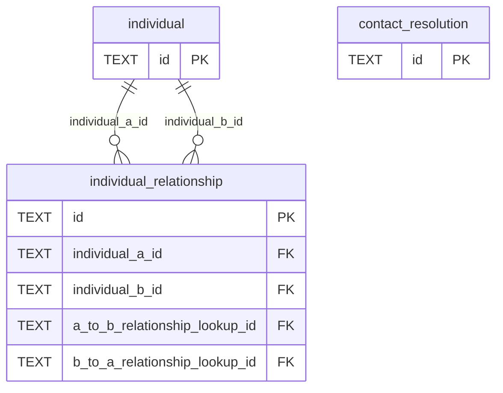

## Contacts, Addresses, and Communication Methods

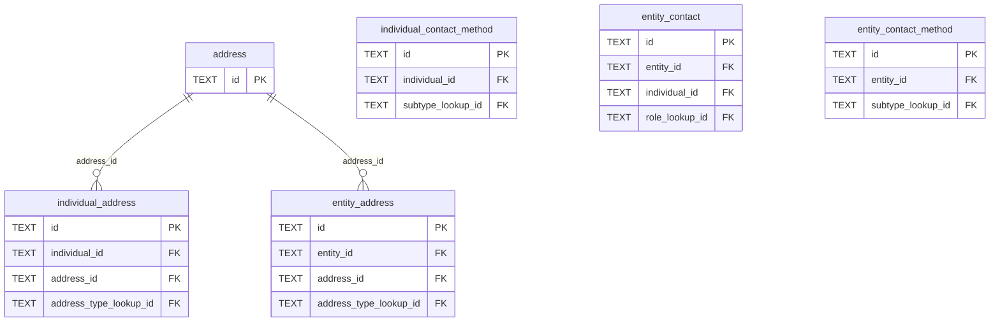

## Clients and Matters

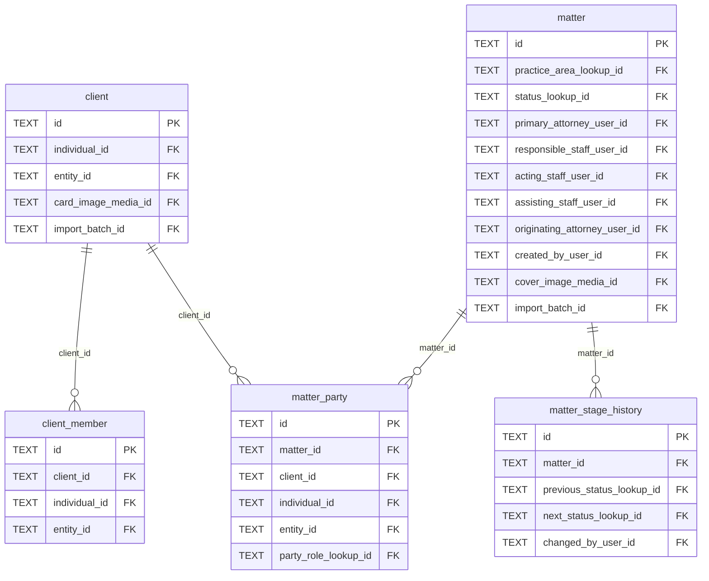

## Matter Participation and Access

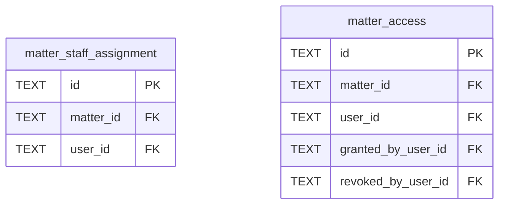

## Intake and Lead Management

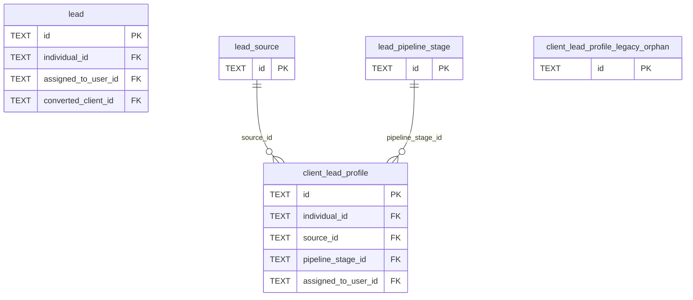

## Notes, Communications, Tasks, and Reminders

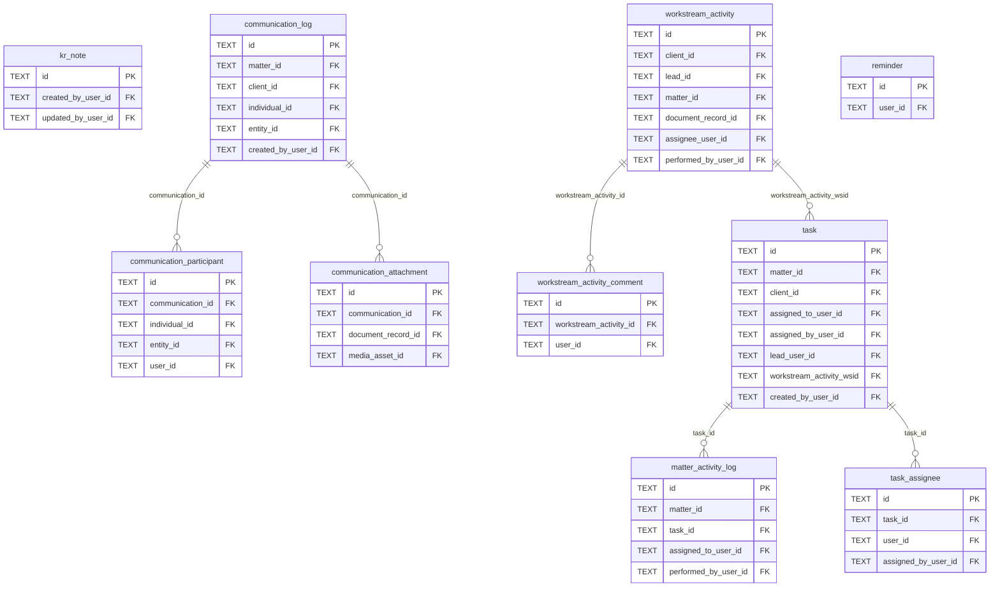

## Calendar and Events

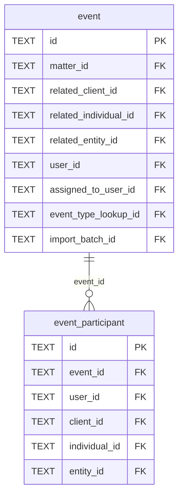

## Conflict Checking

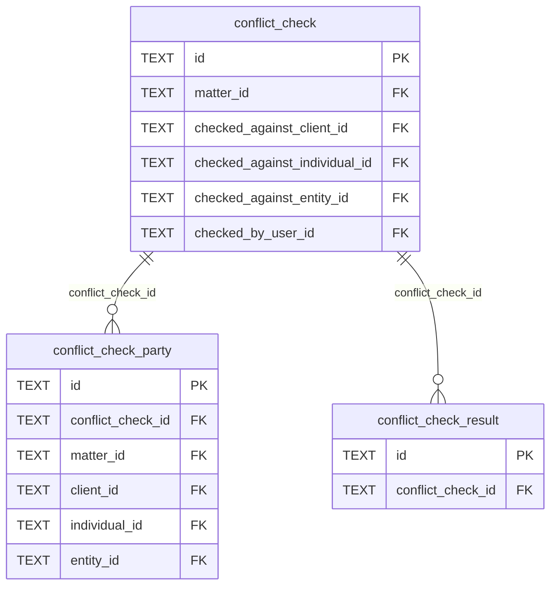

## Time and Expenses

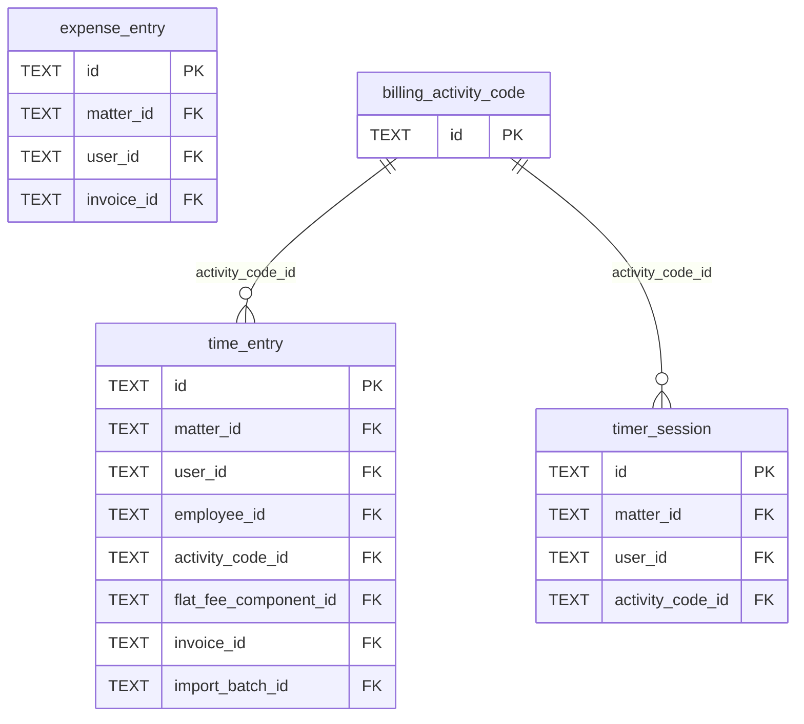

## Billing, Ledger, Payments, and Trust

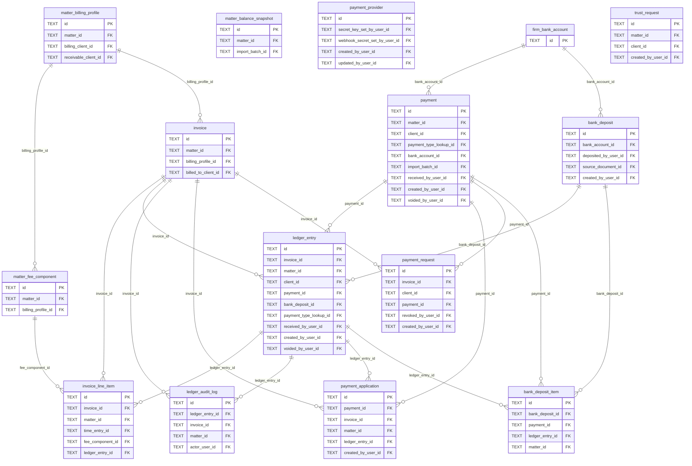

## Documents, Media, and Templates

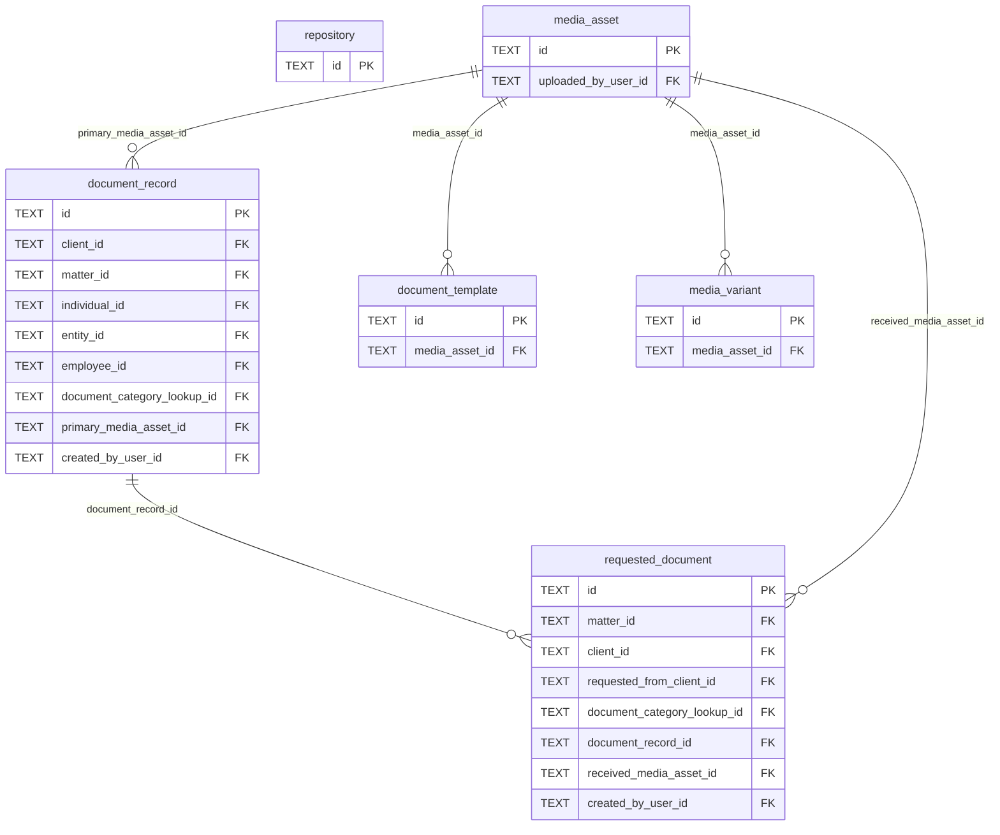

## Estate Planning, Assets, and Funding

```mermaid
erDiagram
  asset {
    TEXT id PK
    TEXT matter_id FK
  }
  asset_detail_bank {
    TEXT id PK
    TEXT asset_id FK
  }
  asset_detail_digital {
    TEXT id PK
    TEXT asset_id FK
  }
  asset_detail_entity {
    TEXT id PK
    TEXT asset_id FK
    TEXT entity_id FK
    TEXT assignment_document_id FK
  }
  asset_detail_insurance {
    TEXT id PK
    TEXT asset_id FK
  }
  asset_detail_real_estate {
    TEXT id PK
    TEXT asset_id FK
    TEXT deed_document_id FK
  }
  asset_detail_retirement {
    TEXT id PK
    TEXT asset_id FK
  }
  asset_detail_tangible {
    TEXT id PK
    TEXT asset_id FK
    TEXT appraisal_document_id FK
  }
  asset_detail_vehicle {
    TEXT id PK
    TEXT asset_id FK
    TEXT title_document_id FK
  }
  asset_ownership {
    TEXT id PK
    TEXT asset_id FK
    TEXT owner_client_id FK
    TEXT owner_individual_id FK
    TEXT owner_entity_id FK
    TEXT co_owner_client_id FK
    TEXT co_owner_individual_id FK
    TEXT co_owner_entity_id FK
  }
  asset_valuation {
    TEXT id PK
    TEXT asset_id FK
  }
  beneficiary_designation {
    TEXT id PK
    TEXT asset_id FK
    TEXT beneficiary_client_id FK
    TEXT beneficiary_individual_id FK
    TEXT beneficiary_entity_id FK
  }
  funding_action {
    TEXT id PK
    TEXT asset_id FK
    TEXT matter_id FK
    TEXT assigned_to_user_id FK
  }
  action_review_stamp {
    TEXT id PK
    TEXT funding_action_id FK
    TEXT user_id FK
  }
  risk_flag {
    TEXT id PK
    TEXT asset_id FK
    TEXT flagged_by_user_id FK
  }
  asset ||--o{ asset_detail_bank : "asset_id"
  asset ||--o{ asset_detail_digital : "asset_id"
  asset ||--o{ asset_detail_entity : "asset_id"
  asset ||--o{ asset_detail_insurance : "asset_id"
  asset ||--o{ asset_detail_real_estate : "asset_id"
  asset ||--o{ asset_detail_retirement : "asset_id"
  asset ||--o{ asset_detail_tangible : "asset_id"
  asset ||--o{ asset_detail_vehicle : "asset_id"
  asset ||--o{ asset_ownership : "asset_id"
  asset ||--o{ asset_valuation : "asset_id"
  asset ||--o{ beneficiary_designation : "asset_id"
  asset ||--o{ funding_action : "asset_id"
  funding_action ||--o{ action_review_stamp : "funding_action_id"
  asset ||--o{ risk_flag : "asset_id"
```

## Business Entities

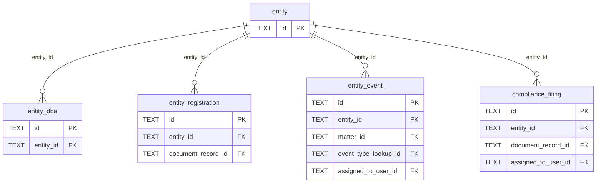

## Public Content Publishing

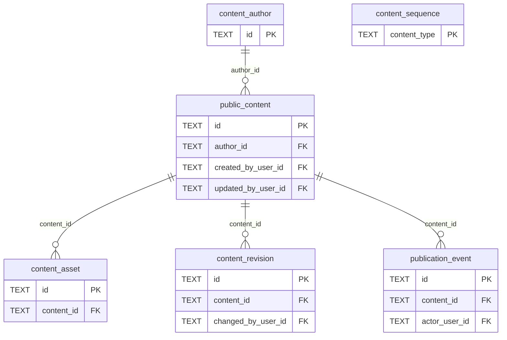

## External Integrations and Import

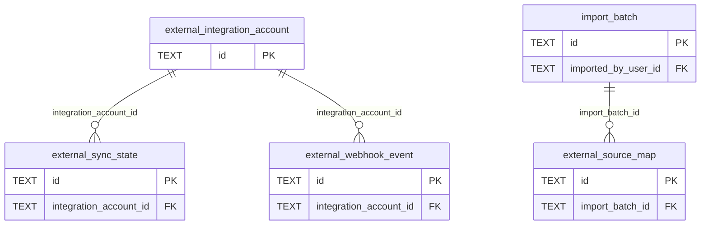

## Users, Roles, Permissions, Sessions, and Audit

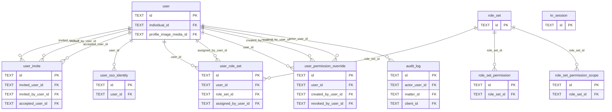

## Employees, Timekeeping, Payroll, and Teams

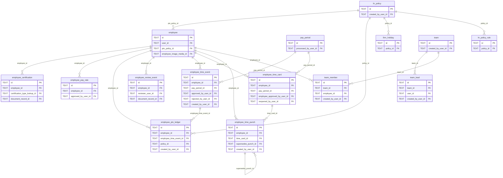

## System Metadata and Configuration

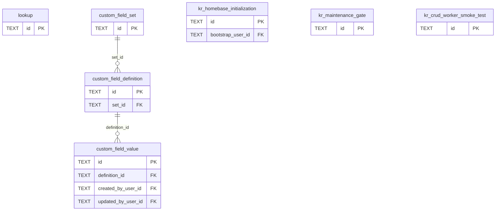
